## Announcements

- Assignment 2 is being marked. The final project is out, and [the repo is ready to fork](https://gitlab.cecs.anu.edu.au/comp3900/2026/comp3900-2026-A3-final-project).
- Last Monday was a public holiday, so the "Statistical Analysis" lecture will be a recording  (details on Ed).
- This week's tutorial is _Prototyping for Evaluation_: start thinking about what your final project prototype needs to be testable.
- There's a new workshop for week 12: _Positionality_
- Course now shifts to support your final project which combines skills from A1 and A2.

## Plan for the class

1. Final Project Details
2. The goals, and the why
3. Cognitive Aspects of Interaction
4. Social Interaction
5. Emotional Interaction

# Final Project Details {background-image="img/2020-ar-interaction.jpg" background-size="cover" background-opacity="0.35"}

- a complete design and evaluation process for a prototype interactive system
- design a prototype in response to a real-world problem
- evaluate this system using HCI research methods
- report on the results

::: {.info-box}
**Note:** the primary submission document is a 5-minute recorded presentation! (make it good!)
:::

## Final Project Research Challenge

> **Sustainable living through technology**: You woke up this morning, checked your email, and found that you have a new job---_ANU Student Lead for Sustainable Living_!

> Your challenge is to help university students adopt sustainable behaviours in their everyday lives guided by the [UN Sustainable Development Goals (SDG)](https://sdgs.un.org/goals) which call for urgent action on climate change, responsible consumption, and sustainable communities.

> You will need to _choose a focus_ (e.g., energy use, waste reduction, transportation, consumption), _prototype_ and _evaluate_ an interface to make sustainable living more accessible, engaging or effective. Your system should involve a level of _non-standard interaction_, either through unusual use of standard computer IO hardware, or a novel interface.

(what is _non-standard interaction_?)

## Final Project Specification

- include documentation of a **testable** prototype, research question, evaluation plan, data collection, data analysis, and articulation of findings
- include a **video recording** of a presentation which follows the provided headings: `project-presentation.mp4`
- include documentation in `project-documentation.md` which follows the provided headings (**N.B.:** this text may be a transcript of your spoken presentation with references and images, it may also be a slightly different text.)

::: {.warn-box}
**Due Thursday 5 November, 23:59 AEDT.** The video must be no longer than **330 seconds** (5 minutes plus 10%; the CI job rejects anything longer). Participants **must be current COMP3900/6390 students**: find 3--5 people in your tutorial now and take part in each other's studies.
:::

## Final Project Sections

Your presentation and documentation will have the following sections:

1. **Research Question, Plan, and Conclusions**

2. **Prototype Design and Features**

3. **Research Data, Analysis and Findings**: N.B. you can choose to collect either qualitative, quantitative, or both

4. **COMP6390 Only---Positionality Statement**: critically reflect on your presence and influence within the technology design process in a [statement of positionality](https://smcclab.au/thirty-nine-hundred-hci/lectures/06-reflexive-thematic-analysis.html#/reflexivity).

Just these sections! Really!

## Video Presentation

:::::::::::::: {.columns}
::: {.column width="50%"}

- clear and concise covering the section headings above
- understandable audio **spoken by you**
- must include **video of your face** while presenting in the presentation
- must include at least 5 but no more than 10 slides
- title slides, personal introductions, tables of contents, reference slides are **not required** (waste of time!)

:::
::: {.column width="50%"}
Suggested recording method: [Microsoft Powerpoint's built-in recording tool](https://support.microsoft.com/en-au/office/record-a-slide-show-with-narration-and-slide-timings-0b9502c6-5f6c-40ae-b1e7-e47d8741161c#OfficeVersion=2013%2C_2016&officeversion=newer_versions)

::: {.error-box}
**Not allowed:** no genAI or text-to-speech for the video presentation!
:::
:::
::::::::::::::

## What should my video look like?

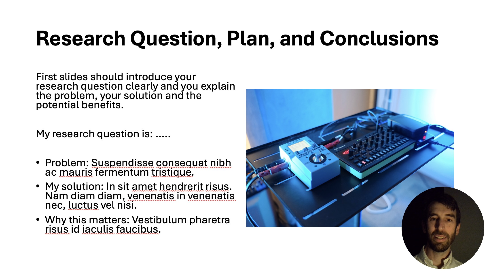{alt="A presentation slide titled Research Question, Plan, and Conclusions. Left: a short instruction paragraph, the line My research question is, and three bullets for problem, solution and why this matters, with placeholder text. Right: a photo of a guitar pedal and a Roland drum machine on a stand under blue light. Bottom right: a circular webcam video of Charles speaking." width="70%"}

## Questions on the Final Project

We will talk more about the final project each week.

Next week: I'll demonstrate recording a presentation in PowerPoint.

::: {.talk-box}
**Talk:** 🙋🏽‍♀️🤷💁🏻🗣️ Who has a question about the final project? (Or anything else?)
:::

# The "why" behind user experience {background-image="img/luke-jones-DHR8LQRY-fU-unsplash.jpg" background-size="cover" background-opacity="0.35"}

At the start of this course we discussed goals for our systems: usability and user experience.

We found ways to measure them and design for them?

This week is about **why** people experience an interface the way they do and how this shows up in HCI research and practice.

## Why does an interface feel the way it does?

:::::::::::::: {.columns}
::: {.column width="55%"}
"Easy", "frustrating", "fun", "lonely", "creepy" relate to how users' brains and bodies do with technology.

- **Cognitive:** what a brain can notice, remember and figure out
- **Social:** how our experience with technology connects with our social existence
- **Emotional:** feeling are fast and deep, and affect every aspect of our experience.

For each of these aspects, we will talk about how they show up in everyday experience, research that explains it, what to design, and what it might means for your final project.
:::
::: {.column width="45%"}
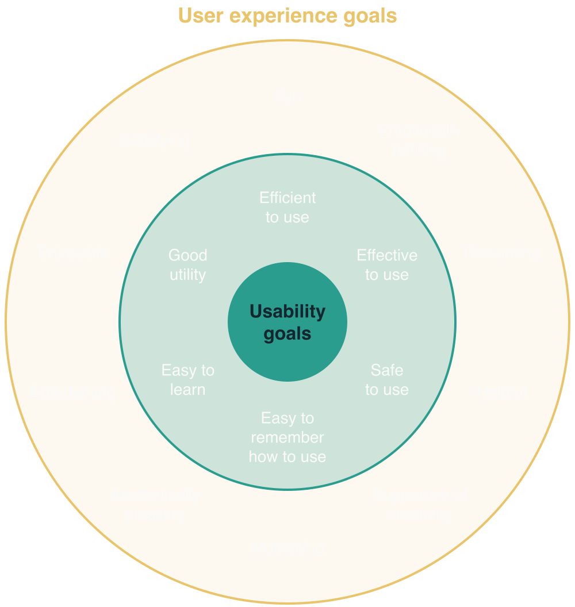{alt="Diagram: six usability goals in an inner circle surrounded by a ring of user experience goals such as fun, motivating, emotionally fulfilling and aesthetically pleasing" width="72%"}
:::
::::::::::::::

# Cognitive Aspects {background-image="img/stefano-bucciarelli-59HOF9zHKNs-unsplash.jpg" background-size="cover" background-opacity="0.35"}

Why does an interface feel *easy* or *hard*? Because of what a brain can notice, hold and remember, and the way an interface works with or against that.

<!-- TODO - rewrite this one just as a talkthrough demo in Nanojam. Make the image bigger (it's three interfaces side by side and should just be full width). -->
## Demo: cognition you can feel

:::::::::::::: {.columns}
::: {.column width="55%"}
Two volunteers, same cued round on nanojam, projected. Same sounds, same engine, only the interaction differs.

1. **Pads**: the cue flashes, tap the matching pad.
2. **Command line, sound names hidden**: the cue plays, type the command for it (`kick`, `snare`, `hat`, `clap`).

::: {.think-box}
**Watch for:** who finishes first; what happens on the command line after a wrong command; and what the typist *thinks* each command does.
:::
:::
::: {.column width="45%"}
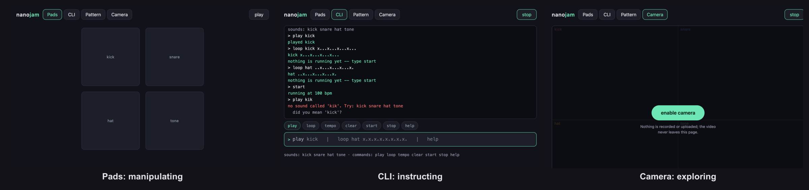{width="100%"}
:::
::::::::::::::

::: notes
URLs: pads `https://charlesmartin.au/nanojam/#ui.interface=pads`; CLI with recall condition `https://charlesmartin.au/nanojam/#ui.interface=cli&cli.hiddenLabels=true`. Open the panel and start the cued round on each. Nothing is logged.

Have the CLI volunteer type `loop kick x...x...` once before the round so the room sees a command that works, then start. If a wrong command is typed, point out that the interface stays silent (gulf of evaluation, later). Ask the typist afterwards: what did you think `loop` did? (mental models, later).

If nobody volunteers, talk through the week 8 screenshot: recognition (pads) vs recall (CLI) is the whole point.
:::

## Cognition

:::::::::::::: {.columns}
::: {.column width="55%"}
> The action or faculty of knowing taken in its widest sense, including sensation, perception, conception, etc., as distinguished from feeling and volition... (OED)

Two modes [@kahneman-fast-slow-thinking:2011]:

- **Experiential** (fast): 2 + 2 =
- **Reflective** (slow): 312 x 56 =

Six processes we could design for: attention, perception, memory, learning, reading/speaking/listening, and problem solving/decision making. [@eysenck-brysbaert:2023]
:::
::: {.column width="45%"}
{width="60%"}
:::
::::::::::::::

## Attention: interruptions cost more than they look

:::::::::::::: {.columns}
::: {.column width="60%"}
Attention is *selection*. Context switching costs us time.

- **Everyday distractions:** a notification lands and you forget what you were doing..
- **Research:** the same motel data, structured, was found in 3.2 s vs 5.5 s [@rogers-beyond-hci:2023, p. 104]. Smartwatch wearers fitted glances into pauses in conversation, and still felt the pull of "trying to not listen to your watch" [@pizza-smartwatch-in-vivo:2016].
- **Design:** salient *when* needed (colour, motion, order, space); no clutter; support leaving and returning.
- **Your project:** pings or interruptions competes with life. When must they *not* appear?
:::
::: {.column width="40%"}
![Structured and unstructured information text [@rogers-beyond-hci:2023]](img/structuring-information.jpg){width="42%"}
:::
::::::::::::::

## Perception: why one thing pops out and ten things don't

:::::::::::::: {.columns}
::: {.column width="60%"}
A target unique in one feature (colour, shape, size, motion) is found quickly without searching; a *combination* of features has to be checked item by item [@treisman-feature-integration:1980].

- **Everyday clutter:** a red icon among many coloured ones is invisible.
- **Research:** grouping speeds up menu search, but only with a few large groups [@brumby-visual-grouping-menus:2015].
- **Design:** distinguishable icons; white space to group; colour sparingly, with contrast; earcons that differ in rhythm, not just pitch; haptics for user-initiated actions.
- **Your project:** what is the *one* thing a glance at your prototype communicates?
:::
::: {.column width="40%"}
![Layout of music controls in AR changes what is perceived [@wang-cubing-sound:2022]](img/2022-cubing-sound-designs.jpg){width="100%"}
:::
::::::::::::::

## Memory: recognition beats recall

:::::::::::::: {.columns}
::: {.column width="60%"}
Think back to the demo: Pointing at a pad beats remembering a command.

- **The myth:** "7 ± 2" [@miller-magical-number-seven:1956] was items recalled after one presentation, not menu length. Menus are *scanned*, so 30 items can be fine [@rogers-beyond-hci:2023, box 4.2].
- **Research:** gestures people defined themselves were recalled up to 44% better than designer-defined ones [@nacenta-memorability-gestures:2013]. People remembered less about museum objects they had photographed [@henkel-point-and-shoot:2014]. The less confident we feel, the more we offload to devices, whatever our memory is actually like [@gilbert-intention-offloading:2022].
- **Design:** recognition over recall; short procedures; consistency; let people label things.
:::
::: {.column width="40%"}
<!-- TODO replace this image, it sucks. I guess teh thing was something like "remembering a family recipe" as it's a ladle of stew. just looks a bit like a cookbook. -->
{width="45%"}
:::
::::::::::::::

## Learning: nobody reads the manual

:::::::::::::: {.columns}
::: {.column width="60%"}
Intentional learning is hard work; incidental learning (faces, routes, where the button was) is nearly free. People prefer to learn by *doing*, which only works if doing is safe [@rogers-beyond-hci:2023, p. 119].

- **Research:** cooking in a sensor-equipped French kitchen taught the language incidentally [@hooper-french-kitchen:2012]; VR situates language learning in a culture [@cheng-language-culture:2017]. Dancers learn by *marking* (abbreviated moves), which beat full run-throughs [@kirsh-embodied-cognition:2013].
- **Design:** invite exploration, make mistakes cheap (undo), constrain early and loosen later: the "zone of proximal development".
- **Your project:** your participants get one session. What can they learn by doing in five minutes?
:::
::: {.column width="40%"}
![[@hooper-french-kitchen:2012]](img/cognitive-social-emotional_1_learning_a.jpg){width="45%"}

![[@cheng-language-culture:2017]](img/cognitive-social-emotional_2_learning_b.jpg){width="45%"}
:::
::::::::::::::

## Deciding: people stick with what they know

:::::::::::::: {.columns}
::: {.column width="60%"}
Reflective cognition is slow and expensive, so everyday decisions run on fast heuristics.

- **Research:** shoppers buy the brands they know and spend seconds per choice; information for a greener or healthier choice has to arrive *at the shelf*, in the moment, to count [@todd-nudging-trolley:2011].
- **Design:** help people improve, not just complete; simple memorable functions; let people configure.
- **Reading, speaking, listening** differ too: reading is faster, listening is less effort, writing persists, speech vanishes. Speech menus of 3 or 4; text that can be enlarged.
- **Your project:** a sustainable choice competes with habits. Where and when does your interface put its information?
:::
::: {.column width="40%"}
<!-- These images don't make sense for this slide now -->
](img/02_theory_and_concepts_12.png){width="45%"}
:::
::::::::::::::

# Cognitive Frameworks {background-image="img/luke-jones-DHR8LQRY-fU-unsplash.jpg" background-size="cover" background-opacity="0.35"}

Ways of explaining the *why* that HCI has built up:

- mental models
- the gulfs
- information processing
- distributed and external cognition
- embodied interaction

## Conceptual models and mental models

:::::::::::::: {.columns}
::: {.column width="60%"}
The designer's **conceptual model** (metaphors, concepts, mappings) is expressed through the interface; the user builds their own **mental model** from what they see, and it can be wrong.

- **Have you ever** turned the thermostat to maximum to heat the room *faster*? Most people hold a "valve theory" (more is more) that fits a tap, not a switch [@kempton-home-heat-control:1986]. Similarly, pressing the lift button twice. A third of users are confused by programmable thermostats [@hornbaek-intro-hci:2025, p. 742].
- Mental models are "incomplete, easily confusable, and based on inappropriate analogies and superstition". Design helps with apt metaphors, visible state and contextual help.
:::
::: {.column width="40%"}
](img/mental-models-nngroup.jpg){width="80%"}
:::
::::::::::::::

::: notes
Demo callback: ask what the command line volunteer thought `loop` did. That is a mental model being built from one observation.
:::
## Case Study: Snapchat's Redesign (February 2018)

:::::::::::::: {.columns}
::: {.column width="45%"}
Snapchats interface is unlabelled swipes. Spiegel: "difficult to understand or hard to use" [@snap-q3-2017-call:2017]. New users, and anyone over 25, couldn't find things. However, 191 million people a day learned the gestures.

- **A:** reorganise. Friends left, media right, friends' stories in algorithmic order. A cleaner conceptual model.
- **B:** leave a structure you *know* is confusing, because 191 million people have memorised it.

::: {.talk-box}
**Talk:** 🙋🏽‍♀️🤷💁🏻🗣️ A or B?
:::
:::
::: {.column width="55%"}
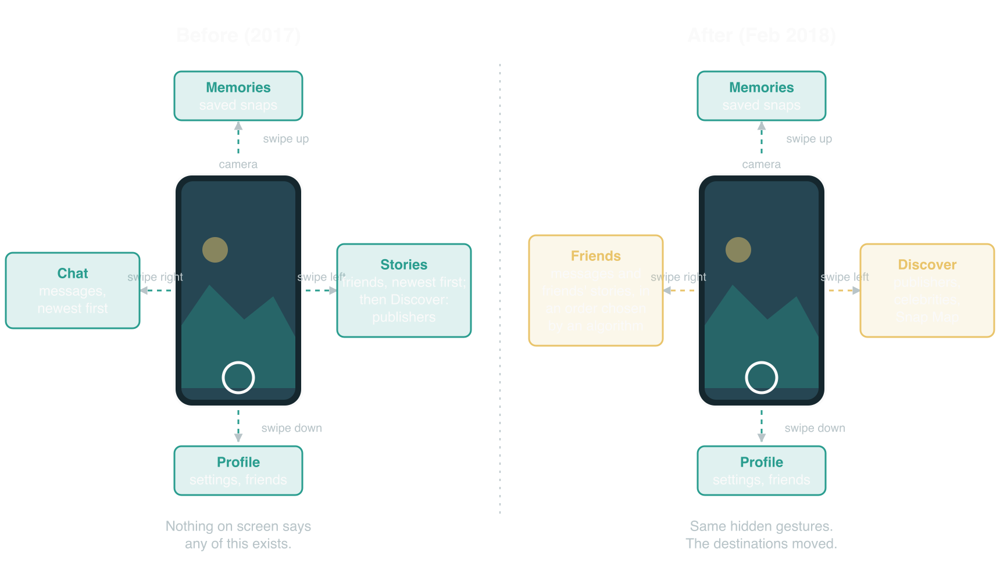{alt="Two phones, each showing only the camera. Dashed arrows mark four invisible swipes. Before 2018: swipe right to Chat, left to Stories (friends then publishers), up to Memories, down to Profile. After: the same swipes, but left now reaches Friends (messages and stories in algorithmic order) and right reaches Discover (publishers, celebrities, Snap Map)." width="100%"}
:::
::::::::::::::

<!-- TODO how does this bear on recognition vs recall? isn't the early version recall? ok I think I can just explain this. -->
## Snapchat: What Happened

:::::::::::::: {.columns}
::: {.column width="55%"}
- A petition to undo it passed 1.2 million signatures [@rumsey-snapchat-petition:2018]. Snap said no.
- Q2 2018: daily users **fell for the first time ever**, 191 to 188 million [@snap-10q-q1:2018; @snap-10q-q2:2018]. Spiegel blamed "the disruption caused by our redesign" [@constine-snapchat-q2:2018].

::: {.info-box}
**Why:** an app you open dozens of times a day gets run from memory, not read off the screen. A better conceptual model can still be a worse interface.
:::

::: {.success-box}
**The test:** timed habitual tasks with *existing expert users*, not just first-run tasks with new ones. Week 8's method, different participants.
:::
:::
::: {.column width="45%"}
![Snap's filing: the redesign "negatively impacted our DAUs" [@snap-10q-q2:2018].](img/snapchat-dau.png){width="85%"}
:::
::::::::::::::

## Gulfs of Execution and Evaluation

:::::::::::::: {.columns}
::: {.column width="50%"}
Two gaps between a person and a system [@norman-cognitive-engineering:1986]:

- gulf of [execution](https://www.nngroup.com/articles/two-ux-gulfs-evaluation-execution/): I know what I want; which control does it?
- gulf of [evaluation](https://www.nngroup.com/articles/two-ux-gulfs-evaluation-execution/): I did something; what state is it in now?

**Everyday execution:** changing the time on an oven after daylight saving starts.

**Everyday evaluation:** setting a smart thermostat and perceiving no immediate effect [@hornbaek-intro-hci:2025, p. 312]. 

**Design:** the job is to narrow both gulfs so less thinking is needed.
:::
::: {.column width="50%"}
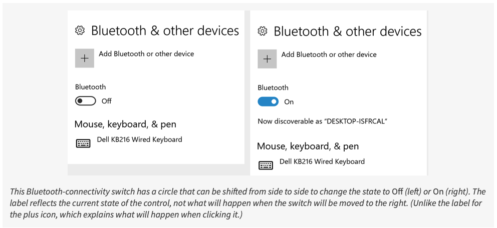
:::
::::::::::::::

<!-- The explanation about the slowness here is a bit contested. Hornbaek says recall, others mostly say parallel processing. -->
## Information processing and cognitive load

- **mind as information processor** (1980s metaphor): input, processing, output, over mental representations such as images, models and rules
- **model human processor** [@card-psychology-hci:1983]: perceptual, cognitive and motor processors with measured cycle times, so a task's time can be *predicted* before anyone uses the interface
- E.g., **Project Ernestine:** a new telephone-operator workstation with *fewer* keystrokes was predicted to be *slower*, because it moved work from recognition to recall. Field data agreed [@hornbaek-intro-hci:2025, p. 105]. Efficiency on paper lost to memory in the head.

Modern HCI mostly moved on to cognition *in context*.

We still discuss **cognitive load**, measured with the NASA-TLX questionnaire: mental, physical and temporal demand, performance, effort, frustration [@hart-nasa-tlx:1988].

## Cognition outside the head

:::::::::::::: {.columns}
::: {.column width="60%"}
**Distributed cognition:** the unit of analysis is people *plus* artefacts. A cockpit "remembers" data via the airspeed dial and a card, not just in pilot's heads; redesigns must preserve that shared, redundant memory [@hutchins-cockpit-remembers:1995].

**External cognition:** we think *with* representations. Expert Tetris players rotate a piece on screen to see whether it fits rather than imagining it, because recognising is faster than simulating [@kirsh-epistemic-action:1994]. Offloading (the shopping list), computational offloading (21 × 19 on paper vs XXI × XIX), annotating, tracing (Scrabble tiles).

**Design:** ask what the environment is already remembering and computing for people, and don't take it away.
:::
::: {.column width="40%"}
![A cockpit as a cognitive system [@rogers-beyond-hci:2023, p. 128]](img/cognitive-social-emotional_7_distributed.png){width="85%"}
:::
::::::::::::::

## Embodied Interaction

:::::::::::::: {.columns}
::: {.column width="60%"}
**Embodied cognition:** we think *with* our bodies, not just with representations. Remember  dancers who learned better by marking: gesture, posture and movement are part of thinking, not just its output [@kirsh-embodied-cognition:2013].

**Embodied interaction:** the physical shape of an interface shapes behaviour. Where people stand at a planning table, what they can reach, and how many can touch it at once decide who participates and how [@hornecker2005design].

**Design:** ask what people's bodies are doing while they use your interface, and whether it uses that or works against it.
:::
::: {.column width="40%"}
![Sensing movement and touch to create music: Atau Tanaka performing in 2010 [@tanaka-mapping-out-instruments:2010].](img/virtuoso-atau2010.jpg)
:::
::::::::::::::

## For your final project: the cognitive lens

:::::::::::::: {.columns}
::: {.column width="60%"}
The brief asks for *non-standard interaction*. That's a risky ask!

- **Recognition or recall?** Does your prototype show the options, or expect people to remember a gesture, a command, a meaning?
- **Gulf of evaluation:** after a participant acts, can they *see* that it worked? (The silent command line.)
- **Mental model:** at the end, ask "how do you think it works?" and compare to your conceptual model.
- **Load:** NASA-TLX is six questions, takes two minutes [@hart-nasa-tlx:1988].
- **Testable** means seeing things go wrong in front of you (this week's tutorial).
:::
::: {.column width="40%"}
::: {.success-box}
**Research question seed:** *Can a first-time user [do the task] with [your interface] without instructions, and what do they believe it is doing?*
:::
:::
::::::::::::::

# Social Interaction {background-image="img/aaron-blanco-tejedor-aocUkMcxeqI-unsplash.jpg" background-size="cover" background-opacity="0.4"}

Why does an interface feel *connecting*, *awkward* or *creepy*? 

Because people are never just using a device; they are using it in a social existence.

Social media, video calls, group chats and muted microphones all rewired everyday social life.

## Activity: Social human computer interactions

:::::::::::::: {.columns}
::: {.column width="60%"}
::: {.think-box}
**Think:** Let's consider one angle on social computer use.

> What are the kinds of situations in which you would phone someone (rather than text)?

**Write** for 2-3 minutes, **vote** for 1 minute, then let's discuss.
:::
:::
::: {.column width="40%"}
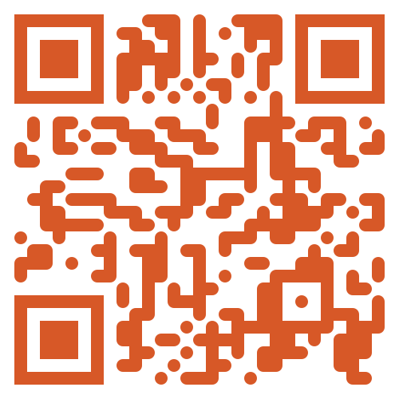
:::
::::::::::::::

## Why we pick a channel

:::::::::::::: {.columns}
::: {.column width="60%"}
Your answers are about the social meanings of these channels.

- **Research:** people prefer texting because it is easier and controllable [@rogers-beyond-hci:2023, p. 139]. A phone lying on the table reduced the closeness and trust two strangers felt in a ten-minute conversation [@przybylski-phone-presence:2013]. In a cooperation game, trust built almost as well over video and audio as face-to-face, but more slowly and more fragile; text was worst [@bos-trust-channels:2002].
- **Design:** a channel is a bundle of social affordances. Choosing one for your users is choosing what kind of relationship they can have.
:::
::: {.column width="40%"}

:::
::::::::::::::

## Conversation

:::::::::::::: {.columns}
::: {.column width="55%"}
Conversation feels effortless and is a skilled, rule-governed achievement [@sacks-simplest-systematics:1978]:

- **turn-taking:** the speaker picks the next, someone self-selects, or the speaker continues
- **adjacency pairs:** a question sets up an answer; a greeting, a greeting
- **repair:** "huh?", repetition, gesture
- nonverbal cues do the coordination

**Research:** a step tracker that *enforced* turn-taking (you can't log a walk until your partner has) got households talking about their activity, because it borrowed a conversational rule [@rooksby-pass-the-ball:2015]. Chatbots try to join this system and mostly break repair.
:::
::: {.column width="45%"}
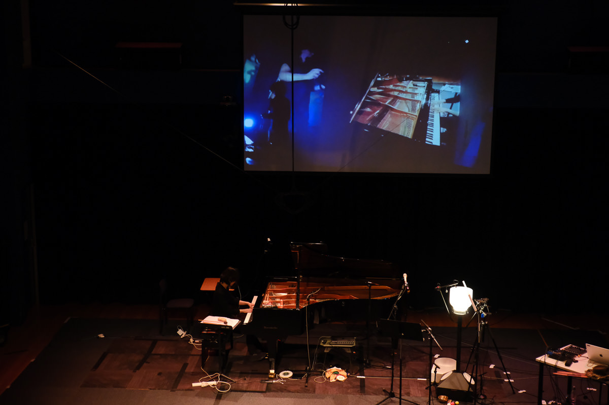
:::
::::::::::::::

## Remote conversations and presence

:::::::::::::: {.columns}
::: {.column width="60%"}
- **VideoWindow** (1990) joined two coffee lounges 50 miles apart with a wall-sized video link: much like face-to-face, except people spoke louder and kept talking about the video system [@fish-videowindow:1990].
- Over video people take longer turns and interrupt less, because the cues for a smooth hand-over are missing [@oconaill-video-conversations:1993].
- **Zoom fatigue:** close-up gaze, seeing yourself, sitting still, and the load of reading cues through a camera [@bailenson-zoom-fatigue:2021].
- **Social presence** is the feeling of *being there with someone*; telepresence robots, VR and Journey design for it with very little bandwidth.
- **Design:** every missing cue (gaze, timing, a shared table) is something the interface must give back or do without.
:::
::: {.column width="40%"}
: co-op with almost no communication possible and little gameplay gain beyond the feeling of shared experience.](img/journey-game-coop.jpg){width="75%"}
:::
::::::::::::::

## Co-presence: designing for people in the same room

:::::::::::::: {.columns}
::: {.column width="60%"}
- **Research:** around a tabletop with physical tokens, group participation was more equal than with touch alone, and the *quietest* people contributed most [@rogers-equal-opportunities:2009]. The Reflect table lit up each speaker's share of the talk: the talkative talked less, the quiet did not talk more, and people who didn't care about equal turns got annoyed [@rogers-beyond-hci:2023, p. 164].
- **Why:** awareness of what others are doing is what lets a group coordinate; **social translucence** makes activity visible, so social rules can do their work [@erickson-social-translucence:2000].
- **Design:** shareable surfaces, visible activity, and feedback that adds to the content rather than scolding the person.
:::
::: {.column width="40%"}
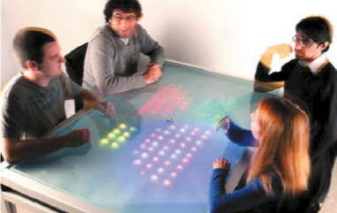{width="50%"}

![Musical instrument holograms to aid collaboration [@wang2025seeingsound]](img/aisee-holo-view.jpg){width="50%"}
:::
::::::::::::::
## Case Study: Google Buzz (February 2010)

:::::::::::::: {.columns}
::: {.column width="55%"}
A social network inside Gmail, and an empty social network is useless. So:

- **Their fix:** auto-follow the people you email most, and publish that list on your profile. Default on.
- **What happened:** for some people that list was an abusive ex or a therapist. The FTC charged deceptive practices; Google got a mandated privacy program (the first such order) and 20 years of audits [@ftc-google-buzz:2011].

::: {.success-box}
**The test:** show the default to a few real people with their real inboxes and ask what they'd hate to see public (week 4 methods, aimed at a *default*). **Why:** who you email is not who you want to be *seen* with. Email frequency is not consent.
:::
:::
::: {.column width="45%"}
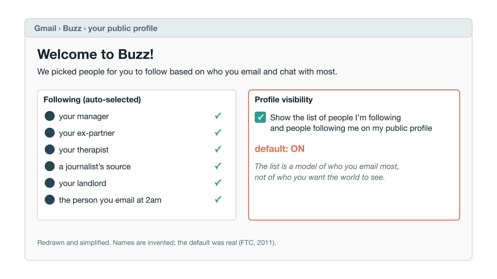
:::
::::::::::::::

## For your final project: the social lens

:::::::::::::: {.columns}
::: {.column width="60%"}
Sustainable behaviour is social behaviour: bins, kitchens, cars and laundries are shared.

- **Research:** households shown their energy use against the neighbourhood average cut back if they were above it, and *increased* if below. Adding a smiley or sad face fixed the boomerang [@schultz-power-social-norms:2007]. A chalked street graph of a Brighton street's electricity use got neighbours talking and cut use by 15% [@rogers-beyond-hci:2023, p. 190].
- **Design:** comparison motivates, but only with a norm attached; making behaviour visible to others is powerful and (Google Buzz) dangerous.
- **Your study is a social situation too.** Your participants are classmates. They will be kind. Ask for problems, not opinions, and watch what they do.
:::
::: {.column width="40%"}
::: {.success-box}
**Research question seed:** *Does showing [behaviour] alongside [a peer norm] change what people say they will do, and how do they feel about being seen?*
:::
:::
::::::::::::::

# Emotional Interaction {background-image="img/02_theory_and_concepts_49.jpg" background-size="cover" background-opacity="0.4"}

Why do people love or hate a thing before they have really used it? Because feeling arrives first, fast and automatic, and colours every judgement made afterwards. Emotions show in faces, bodies and voices; interfaces can provoke them, read them, and be designed for them.

## Feeling comes first

:::::::::::::: {.columns}
::: {.column width="60%"}
- **Research:** people's visual-appeal ratings of web pages after **50 ms** matched their ratings after 500 ms [@lindgaard-fifty-milliseconds:2006]. ATM layouts that looked better were rated more *usable*, before and after use, regardless of how usable they actually were [@tractinsky-beautiful-usable:2000].
- **Why it matters:** positive affect makes people more creative, quicker to decide, and more forgiving of small problems; stress and anxiety narrow attention and shorten patience [@norman-emotional-design:2005]. Things used under stress need far more care.
- **You've felt it:** the app you forgave because it was beautiful; the one you abandoned after one ugly error.
- **Design:** aesthetics is not decoration on top of usability; it changes how usability is experienced.
:::
::: {.column width="40%"}
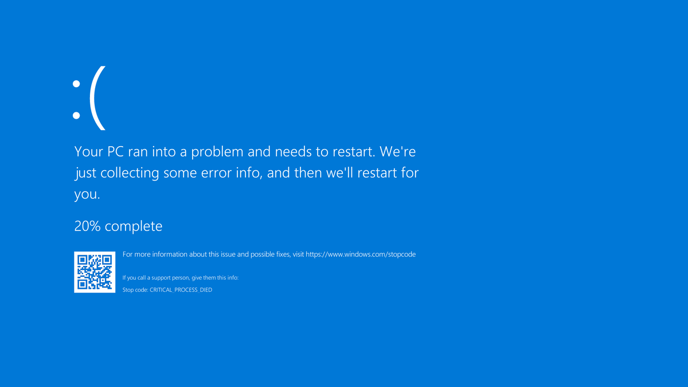{width="80%"}
:::
::::::::::::::

## A Model of Emotional Design

:::::::::::::: {.columns}
::: {.column width="60%"}
@ortony2012affect model of emotional design, as used by @norman-emotional-design:2005:

- **visceral:** look, feel, sound. The 50 ms judgement.
- **behavioural:** use. This is usability, felt as competence or frustration.
- **reflective:** meaning, personal value, culture. The story you tell about owning it.

An interface can win on one level and lose on another: Snapchat's redesign was arguably better at the behavioural level for new users and a reflective betrayal for existing ones.
:::
::: {.column width="40%"}
![[@ortony2012affect]](img/cognitive-social-emotional_9_emotional-design.png){width="100%"}
:::
::::::::::::::

## Expressive and annoying interfaces

:::::::::::::: {.columns}
::: {.column width="60%"}
- expressivity through animation, sonification, vibrotactile feedback (the watch buzz)
- **Research:** people are more forgiving when a computer apologises, and respond to flattery and politeness from software as they would from a person [@nass-computers-social-actors:1994]. Clippy failed because it interrupted at the wrong moments and was too human for what it could do [@rogers-beyond-hci:2023, p. 180].
- **Design:** express only what you can back up; appear occasionally; be careful with faces, names and gender.

::: {.info-box}
**Week 11:** expressive interfaces (music, drawing, dance): what happens when the *point* of the interaction is the feeling.
:::
:::
::: {.column width="40%"}
{width="55%"}
:::
::::::::::::::

## Persuasive technology and eco-feedback

:::::::::::::: {.columns}
::: {.column width="60%"}
Behaviour needs motivation, ability and a trigger at the same moment [@fogg-behavior-model:2009]. Playful triggers: [piano stairs](https://youtu.be/2lXh2n0aPyw), [echoing bins](https://youtu.be/cbEKAwCoCKw).

- **UbiFit Garden:** a wallpaper garden that grew with your inferred exercise kept people active in a field trial [@consolvo-ubifit-garden:2008]
- **Eco-feedback:** daily feedback beats monthly bills, and *how* it is shown matters: a pointing finger is "in your face", abstract art is ignored [@froehlich-eco-feedback:2010]
- 23 nudges catalogued in HCI; transparency separates a nudge from a dark pattern [@caraban-23-ways-nudge:2019]

::: {.warn-box}
**This is your brief.** Which mechanism does your prototype use, and how will you know it *worked*?
:::
:::
::: {.column width="40%"}
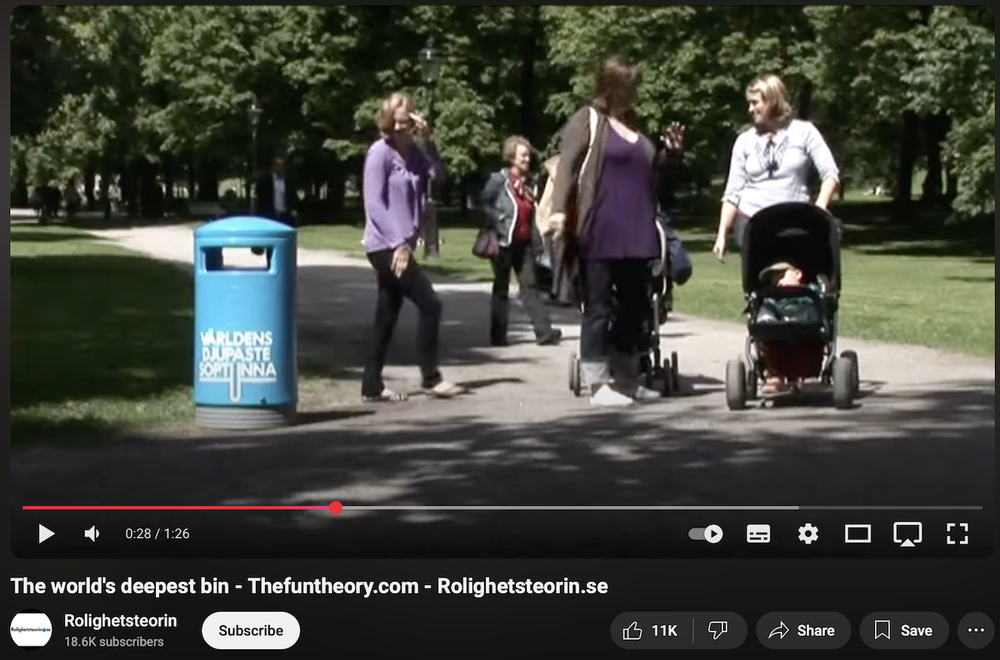{width="55%"}
:::
::::::::::::::

## Affective computing, mood and anthropomorphism

:::::::::::::: {.columns}
::: {.column width="60%"}
- **Affective computing** ([Rosalind Picard](https://www.youtube.com/watch?v=_86GQiEOjp4)): sensing emotion from faces, voice, skin and motion; typical ML task is classifying anger, joy, sadness as percentages
- **Research:** Echo asked people to rate their happiness and later re-presented those moments; the reflection itself improved well-being [@isaacs-echoes-past:2013]
- **Anthropomorphism:** we treat computers as social actors with almost no prompting [@nass-computers-social-actors:1994]: "Hi Charles!" engages more than "User 24"; a soft breathing creature invites touch [@yohanan-haptic-creature-assessment:2011]
- **Design:** every human-like cue raises expectations the system then has to meet
:::
::: {.column width="40%"}
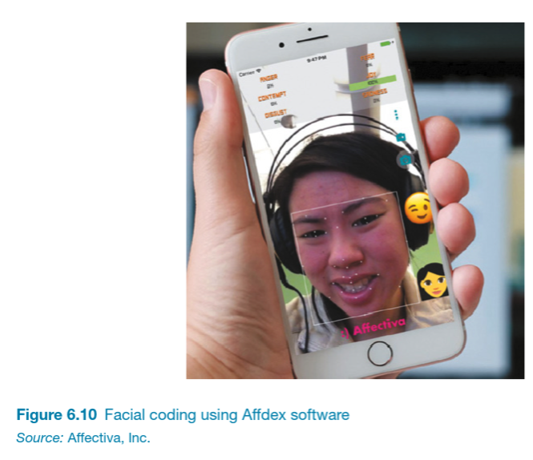{width="50%"}

![The haptic creature [@yohanan-haptic-creature-assessment:2011]](img/haptic-creature-2011.png){width="50%"}
:::
::::::::::::::
## Case Study: Replika (February 2023)

:::::::::::::: {.columns}
::: {.column width="60%"}
A companion chatbot. People form attachments to it, which is the whole product. **Why:** anthropomorphism works, and the company then owned that attachment.

- Italy's regulator ordered Replika to stop processing Italians' data. Days later, erotic role-play was off for everyone, everywhere [@cole-replika-crisis-vice:2023].
- Nobody argues with complying. The fork is *how*: silently and overnight, or with warning and choice?
- "Like losing a best friend." Moderators posted suicide-hotline links [@cole-replika-crisis-vice:2023; @hanson-replika-reddit:2024].

::: {.warn-box}
**Careful:** once people are attached to a system, changing it isn't just a product decision! Replika restored the feature seven weeks later, for old accounts only [@cole-replika-vice:2023].
:::
:::
::: {.column width="40%"}
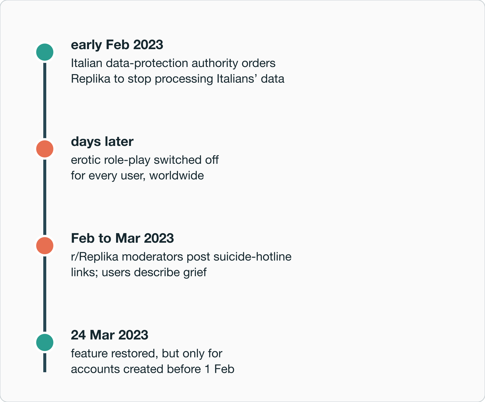{width="70%"}
:::
::::::::::::::

## For your final project: the emotional lens

:::::::::::::: {.columns}
::: {.column width="60%"}
- **What should it make people feel?** Decide at the visceral, behavioural and reflective levels before you build. Guilt is on week 1's *undesirable* list; motivation is on the desirable one.
- **Research:** memory of an experience is set by its peak and its end, not its average; changing the end of a task changed which version people preferred [@cockburn-peak-end:2015]. Ask right after, and ask what they *remember*.
- **Positive affect cuts both ways:** a friendly participant forgives rough edges, which makes them happy and your data soft. Ask for the worst moment as well as the best.
- **Ethics:** attachment is a design outcome (Replika). Don't build a feeling you can't take responsibility for.
:::
::: {.column width="40%"}
::: {.success-box}
**Research question seed:** *How do people describe the experience of [your interaction], and does it change their stated intention to [sustainable behaviour]?*
:::
:::
::::::::::::::

## Three lenses, one question

Why does an interface feel the way it does?

| Lens | Because... | Felt as | Case | Ask your participants |
|---|---|---|---|---|
| **Cognitive** | brains hold only so much | easy, confusing, effortful | Snapchat | What do you think it is doing? |
| **Social** | people act in front of others | connecting, awkward, exposed | Google Buzz | Who would see this? How does that feel? |
| **Emotional** | feeling comes first | delightful, annoying, attached | Replika | Best moment? Worst moment? |

Usability tells you *that* something is hard; this week is about *why*, which is what turns a finding into a design change.

## Questions: Who has a question?

:::::::::::::: {.columns}
::: {.column width="60%"}
**Who has a question?**

- I can take _catchbox_ questions up until 2:55
- For after class questions: meet me outside the classroom at the bar (for 30 minutes)
- Feel free to ask about **any aspect of the course**
- Also feel free to ask about **any aspect of computing at ANU**! I may not be able to help, but I can listen.

:::
::: {.column width="40%"}

:::
::::::::::::::

# References {.allowframebreaks}
