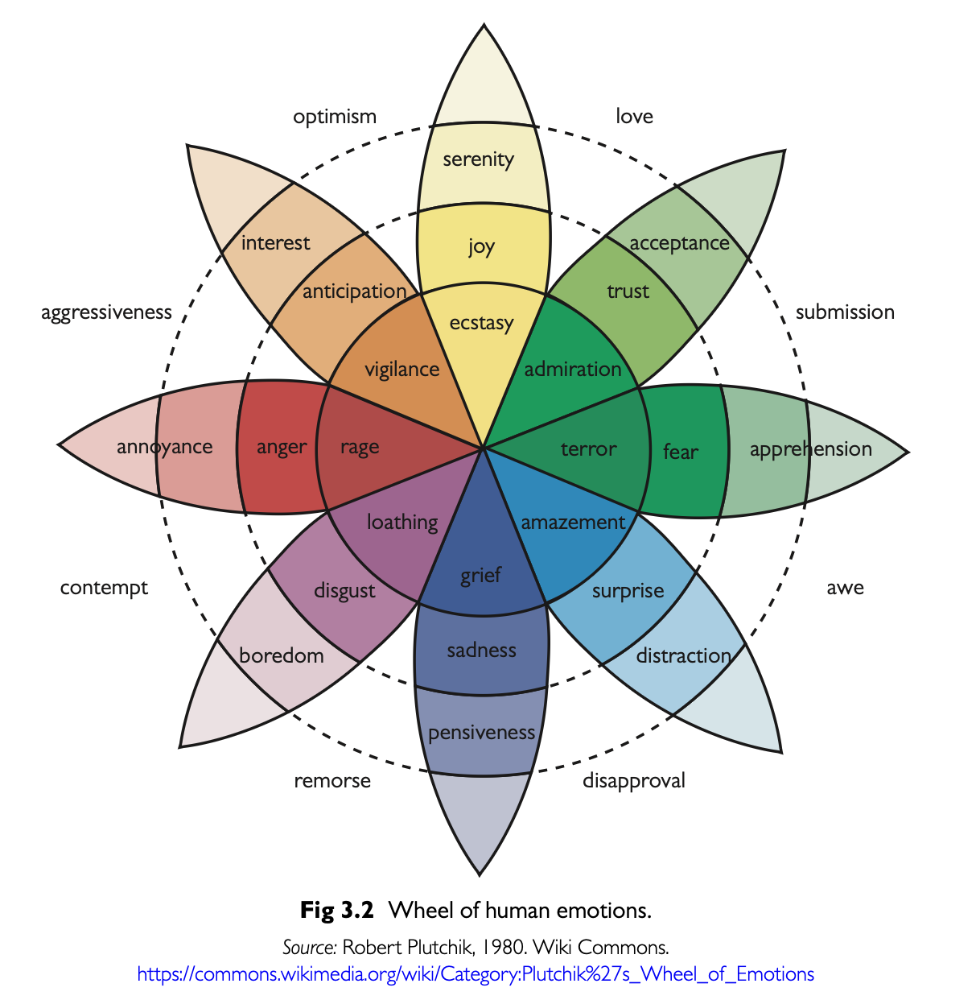
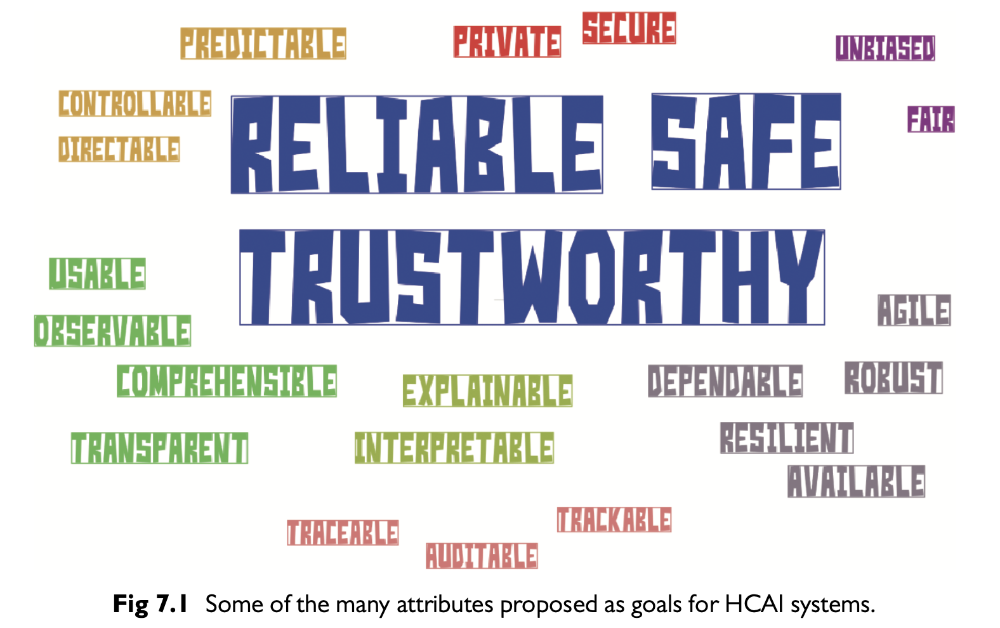
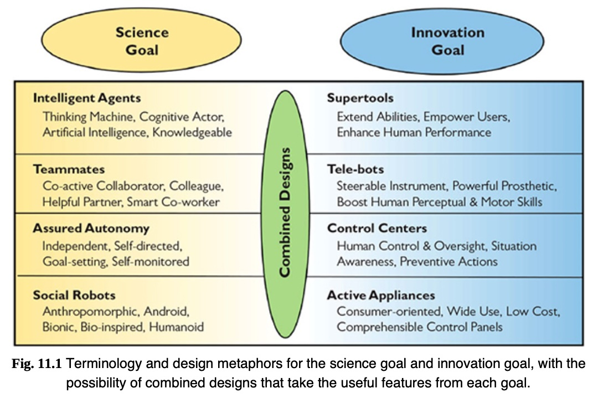
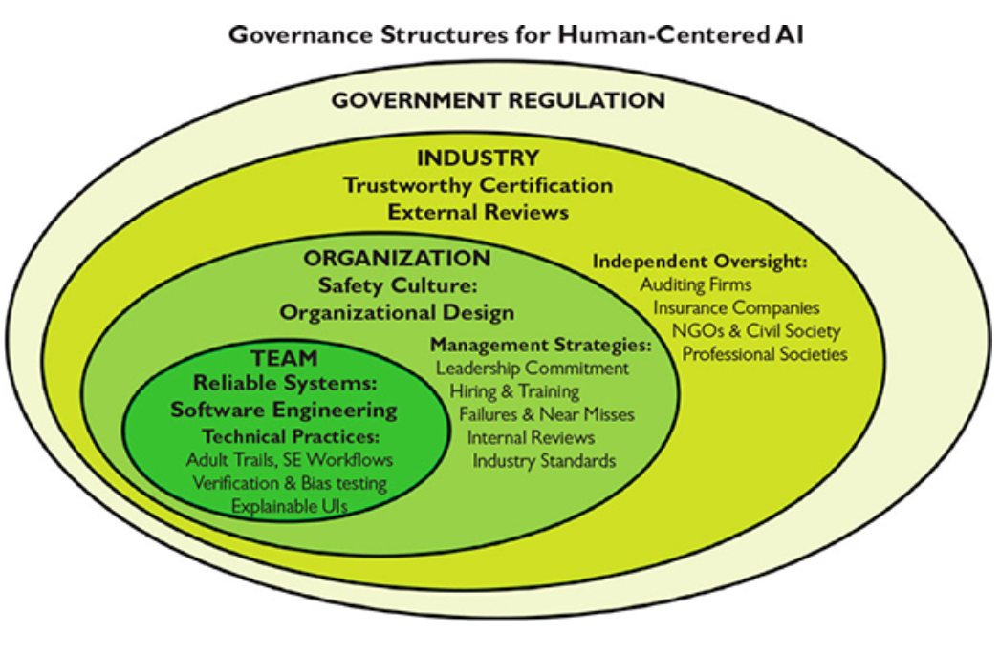

## Announcements

- tutorial marks: best 10 of 11 workshops count; all marks entered.
- congrats to the legends who **maxed** out 100% on tutorials!
- [SELT](https://services.anu.edu.au/learning-teaching/education-data/student-experience-of-learning-teaching-selt/information-for-students) is open --- fill in your SELT!
<!-- TODO before delivery: confirm all 11 tutorial marks are entered and count the 100%ers (2025: 107); confirm SELT 2026 open dates. -->

::: {.info-box}
**Note:** your SELT is a gift to future students, and gives me confidence to advocate for good practice!
:::

### Final Project

- brings all skills from the course together
- idea is that these are mini HCI-research papers
- prepare you for further research, exploration in HCI and assess all skills in the course
- let's look at the forking numbers for the [assignment repo](https://gitlab.comp.anu.edu.au/comp3900/2026/comp3900-2026-A3-final-project)

::: {.warn-box}
**Deadline:** Thursday 5 November, 23:59. About a week left for your final project.
:::

## Plan for the class

:::::::::::::: {.columns}
::: {.column width="60%"}

- a few notes wrapping up the course
- **human-centred AI** [@shneiderman-human-centered-ai:2022]: a framework written in 2021, *before* ChatGPT, agents, and agentic coding.
- today we test that framework against what actually happened: what held, what broke, what it couldn't see.
- what this means for *your* final project (an A3 checklist, not a revision lecture)
:::
::: {.column width="40%"}
{width=70%}
:::
::::::::::::::

## Course stats

:::::::::::::: {.columns}
::: {.column width="60%"}

- ~190 students at peak, 184 now (109 COMP3900, 75 COMP6390) --- a bit smaller than 2025's record 330.
- Git commits this semester: 155
- Slides: 603 slides, 47K words, 353 images. Tutorials: 11 workshops, 18K words.
- Forum (Ed, to 23 Oct): ~2K threads (1,820 are pre-class task posts), 139 answers, 984 comments, 330 hearts.
  - 108K views; the biggest viewer looked at 4,906 threads (I only viewed 1,994!)
  - Charles answered 110 questions and left 74 comments.

Takeaway: slides and tutorials alone are ~65K words, more than a PhD thesis (~50K). Yikes! 😦
:::
::: {.column width="40%"}

<!-- TODO: hci-commits.jpg is the 2025 insights screenshot; regenerate from github.com/smcclab/thirty-nine-hundred-hci/pulse or graphs/commit-activity -->
:::
::::::::::::::

# What is Human-Centered AI (HCAI)?

{width=50%}

## HCAI

@shneiderman-human-centered-ai:2022 proposes combining human-centred thinking with AI-based algorithms to create HCAI

- increase chance of AI empowering rather than replacing people
- give equal attention to human users and other stakeholders when developing AI systems
- HCAI developers would value meaningful human control
- serve human values: rights, justice, dignity
- goals: self-efficacy, creativity, social connection

## Why is this important?

- AI is the transformational technology of our time *(Charles, 2025)*
- Applying AI well is a *massive* HCI challenge, probably bigger than any before
- We don't have good enough frameworks to understand HCAI

Evidence:

- lots of AI papers involving humans wrongly sent to CHI conference, frustrating reviewers
- AI collaboration technology currently at the level of CLI (chatGPT) or confusing magical tools (agentic coding, e.g., copilot in VSCode)
- *So many* research questions in this area.
- news preoccupation with risks of AI taking over, not capacity of actual products

## How is HCAI different to AI?

@shneiderman-human-centered-ai:2022 points to two differences between AI and HCAI:

1. **process:** HCAI builds on user experience design methods (e.g., data gathering, stakeholder engagements, etc.) in use of systems that employ AI and ML
2. **product:** HCAI systems supposed to be *supertools* that amplify, augment, empower and enhance human performance

Critical points here:

- Research methods for AI/ML, primarily statistical/logical modelling, very quant, much different than design methods.
- HCAI *supertools* emphasise human control and the enhancement of the human's capability and experience, not the AI/ML algorithms capability.
- Examples of *supertools*: digital cameras, navigation systems

## White Robot vs Supertool

:::::::::::::: {.columns}
::: {.column width="60%"}

AI reporting frequently applies simplistic tropes for AI systems.

- "white robot" (technoutopian)
- "terminator" (technodystopian)

These tropes mirror people, not computer systems. White robots are naive but noble people (can be turned to evil), terminators are evil people (can be redeemed)

### Supertool

- Shneiderman's "supertool" enables us to consider how AI fits into existing tool use.
- Not a complete solution, still lots of questions and unknowns!

:::
::: {.column width="40%"}
{width=60%}
:::
::::::::::::::

## Human-Centred AI Structure

:::::::::::::: {.columns}
::: {.column width="50%"}
Three big ideas:

- HCAI framework: guide human-centric thinking for creative design
- design metaphors: practical ideas for designing HCAI systems *(not white robots)*
- governance structures: practice steps to realise ethical principles

Support:

- design aspirations
- individual goals
- human values (most important!)
:::
::: {.column width="50%"}

:::
::::::::::::::

## People and Computers

:::::::::::::: {.columns}
::: {.column width="60%"}

@shneiderman-human-centered-ai:2022 argues against AI goals that equate computers with people.

- people are already good at lots of things (celebrate that)
- argues to change from simulating human behaviour to enhancing it.
- As an example:
  - people are good at emotions, and sensitive to them.
  - people can be disturbed by emotional simulations in robots

Rather than anthropomorphic systems: argues for Creativity Support Tools (CSTs) (see *Expressive Interaction*), direct manipulation interfaces (see *Interfaces*)
:::
::: {.column width="40%"}

:::
::::::::::::::

# HCAI frameworks {background-image="img/2024-seoul-framework.jpg" background-size="cover" background-opacity="0.4"}

## Why start with a framework?

Interaction designers love good frameworks.

Two good reasons to investigate a framework for HCAI.

1. Understand different capabilities of present and near future systems.
2. See opportunities (gaps) for new design ideas, or different versions of the same idea.

## Rising above levels of automation

:::::::::::::: {.columns}
::: {.column width="40%"}

- @shneiderman-human-centered-ai:2022 critiques standard models of autonomy/automation by computers.
- e.g., @parasuraman-automation-model:2000 model of levels of autonomy.
- typically, autonomy is seen as 1D spectrum
- so if the computer is autonomous, the human does nothing.

What if both computer and human can have autonomy?
:::
::: {.column width="60%"}

:::: {.small-table}

| level | the computer... |
| --- | --- |
| 10 | (High) decides everything and acts autonomously, ignoring the human |
| 9 | informs the human only if the computer decides to |
| 8 | informs the human only if asked |
| 7 | executes automatically, then necessarily informs the human |
| 6 | allows the human a restricted time to veto before automatic execution |
| 5 | executes the suggestion, if the human approves |
| 4 | suggests one alternative |
| 3 | narrows the selection down to a few |
| 2 | offers a complete set of decision-and-action alternatives |
| 1 | (Low) offers no assistance; the human must take all decisions and actions |

::::

:::
::::::::::::::

## Reverse Centaurs and Bad Kinds of Automation

[Cory Doctorow recently writes about "reverse centaurs"](https://doctorow.medium.com/https-pluralistic-net-2025-09-11-vulgar-thatcherism-there-is-an-alternative-f1428b42a8fd) as a [model for bad kinds of automation](https://doctorow.medium.com/https-pluralistic-net-2025-09-11-vulgar-thatcherism-there-is-an-alternative-f1428b42a8fd).

The idea is:

- **a centaur:** a powerful steed (the horse) with the head of an (intelligent and knowledgeable) person.
- a **reverse centaur:** a person's (slow and weak) body with the head of a (much lower intelligence) animal.

Examples:

- freelance writer put under ridiculous deadlines acting as an "accountability sink" for chatGPT.
- vibe-coding a whole app: "checking" for bugs is slow and hard and puts responsibility on the vibe-coder to find problems

## Defining Reliable, Safe, Trustworthy Systems

:::::::::::::: {.columns}
::: {.column width="60%"}

- **reliable:** produce expected responses when needed
  - comes from good *engineering*, verification, validation
  - technical audit trails when things go wrong
- **safe:** social/cultural commitment
  - reporting failures and near misses
  - review of problems and solutions
- **trustworthy:** what *people* want from a system
  - independent oversight (certification, regulation, insurance)
  - (communication and understandable context)

:::
::: {.column width="40%"}

:::
::::::::::::::

## Two Dimensional HCAI Framework

:::::::::::::: {.columns}
::: {.column width="50%"}

- existing 1D framework poses an unhelpful zero-sum tradeoff in automation
- **problem:** full automation seems like the only goal
- **2D framework:** computer and human control can both be useful in different contexts
- helps understand existing systems, and find dangerous areas

:::
::: {.column width="50%"}

:::
::::::::::::::

## Eight Design Guidelines for HCAI

Shneiderman, famous for the *Eight Golden Rules for Design* proposes a new set!

:::::::::::::: {.columns}
::: {.column width="50%"}

1. Overview first, zoom and filter, then details-on-demand
2. Preview first, select and initiate, then manage execution
3. Steer by way of interactive control panels
4. Capture history and audit trails from powerful sensors

:::
::: {.column width="50%"}

1. People thrive on human-to-human communication
2. Be cautious when outcomes are consequential
3. Prevent adversarial attacks
4. Incident reporting websites accelerate refinement

:::
::::::::::::::

## Processes

- **Overview first, zoom and filter, then details-on-demand:**
  - give users agency over information abstraction, make sure the details are available!
  - Relates to visualisation in particular, but many other kinds of information.

- **Preview first, select and initiate, then manage execution:**
  - for automated processes, users should have a preview of all steps, ways to select a plan, and to manage the execution. - works for navigation, parking, cameras (how about MS Copilot?)

- **Steer by way of interactive control panels:**
  - give users ways to steer processes. "control panels" can be joysticks, sliders, gestural controls.
  - this may be a good place for *expressive interaction* knowledge to help map simple controls to complex outcomes.
  - evisages AR/VR as good way to assist here.

## History, Sharing, and Hazards

- **Capture history and audit trails from powerful sensors:**
  - Cars and aeroplanes capture lots of data about usage to help diagnose issues when things go wrong, so can apps.
  - Problem: could this lead to excessive data collection and privacy issues.
- **People thrive on human-to-human communication:**
  - people like to share content and experiences
  - collaborative work makes us better.
  - consider: buzz about chatGPT relates to gurus/power-users sharing tips.
- **Be cautious when outcomes are consequential:**
  - humility is a good attribute for designers
  - thorough evaluation and continuous monitoring more important with high risk
  - (how do LLMs manage this? poorly so far!)

## Responsibliity and Feedback

- **Prevent adversarial attacks:**
  - failures from vandals or baddies disrupt normal use and cause badness in the world.
  - how can we prevent these issues? Security and governance but also design.
- **Incident reporting websites accelerate refinement:**
  - openness to feedback leads to technology improvement
  - something like "bug bounties" for HCAI systems

# Design Metaphors {background-image="img/hal-9000.jpg" background-size="cover" background-opacity="0.35"}

:::::::::::::: {.columns}
::: {.column width="60%"}
Metaphors useful for clarifying design ideas.

- Steve Jobs famously called computers "bicycles for the mind"
- @shneiderman-human-centered-ai:2022 looks for metaphors to dig further into the two dimensions of the HCAI framework
- starting point are *science* and *innovation*
  - **science:** understand principles that make intelligent behaviour possible in a computer
  - **innovation:** create computers that amplify human abilities

:::
::: {.column width="40%"}
{width="100%"}
:::
::::::::::::::

## Science vs Innovation Goals

:::::::::::::: {.columns}
::: {.column width="60%"}
Science and innovation goals can come into conflict. Significant amounts of design sometimes needed to turn a scientific output into a product.

### Autonomous social robots

- Science goals: a general purpose robot elders, parcel delivery, etc.
- Innovation goals: tune solution for each context of use.

### Online meeting services

- Science: devices / software support collaboration.
- Innovation: Microsoft Teams, Zoom, Google meet.
:::
::: {.column width="40%"}
{width="50%"}
:::
::::::::::::::

## Intelligent Agents and Supertools

:::::::::::::: {.columns}
::: {.column width="60%"}

- early computers were labeled "thinking machines" and "electronic brains".
- @martin1933myth argues that such myths slowed workplace acceptance and created unrealistic expectations
- @turing1950computing asked "Can Machines Think?"
    - Envisioned machines competing with humans in intellectual fields
- debate: a deceptive metaphor rather than a meaningful test [@natale2021deceitful]
- pop culture influence of powerful thinking machines and robots

:::
::: {.column width="40%"}
](img/hal-9000.jpg){width="100%"}
:::
::::::::::::::

## Case Study: Air Canada's Chatbot (2022 to 2024)

:::::::::::::: {.columns}
::: {.column width="50%"}
You run an airline website. Customers ask about policies, how should a bot help?

- **A:** a chatbot that answers in its own words. Fewer clicks, plain language. Better on most week 8 measures.
- **B:** a bot that only *finds and links* the policy page. Boring, and it makes people read.

::: {.talk-box}
**Talk:** 🙋🏽‍♀️🤷💁🏻🗣️ A or B? If A, who's responsible when it gets a policy wrong: customer, vendor, airline, or bot? 2 minutes.
:::
:::
::: {.column width="50%"}

:::
::::::::::::::

## Air Canada: What Happened

:::::::::::::: {.columns}
::: {.column width="60%"}
- The bot said Jake Moffatt could claim a bereavement fare *after* flying. The page it linked to said no.
- Air Canada's position: the chatbot is "a separate legal entity that is responsible for its own actions". The tribunal: it "is still just a part of Air Canada's website", and awarded C$812 [@moffatt-v-air-canada:2024].

::: {.info-box}
**Concept:** the *intelligent agent* metaphor lost in court to the *supertool* view. What an AI feature says for a company counts as a claim by the company.
:::

::: {.success-box}
**The test for your project:** ask it questions you already know the answer to, and check that it links the source instead of asserting the answer itself.
:::
:::
::: {.column width="40%"}

:::
::::::::::::::

## Case Study: Google Photos (2015 to 2023)

:::::::::::::: {.columns}
::: {.column width="55%"}
In 2015 the app labelled photos of Jacky Alciné and a friend, both Black, as "gorillas".

- **The fork:** fix the model, or remove the failing capability from the interface?
- **Google:** removed the label. In 2023 the *New York Times* found "gorilla" and several other primates still absent, eight years on [@grant-hill-gorillas:2023].

::: {.think-box}
**Think:** an interface-level fix still in place after eight years: engineering honesty, or a cover-up? I genuinely don't know. Good last question for the course.
:::
:::
::: {.column width="45%"}

:::
::::::::::::::

## Towards supertool designs

> combine intelligent agents with human-controlled tools to ensure trust, usability, and control

- human-computer sybiosis explored from 60s: humans make decisions; computers handle routine tasks [@licklider1960man]
- human-AI design debate: automation vs direct user control [@shneiderman-direct-manipulation-agents:1997].
- Maes: Advocated for proactive software agents that anticipate user needs.

AI in conferences & applications:

- science Goal (AI researchers): automated performance (e.g., self-driving cars, reading x-rays).
- innovation Goal (HCAI researchers): promote human-supervised tools (e.g., SIGCHI, UXPA, Augmented Humans conferences)

## Teammates and Tele-bots

:::::::::::::: {.columns}
::: {.column width="60%"}

- **Teammates:** modelling human-robot interaction after human-human interaction
- **Telebots:** remote-controlled systems with high degrees of automation but ultimately human control

Teammate approach has many challenges [@klien2004ten]:

- Unmet expectation to disappointment.
- False beliefs about robot autonomy/responsibility.
- Emotional attachment can mislead usage.

:::
::: {.column width="40%"}
{width="50%"}
:::
::::::::::::::

## Designs for Tele-bots

:::::::::::::: {.columns}
::: {.column width="60%"}

- Human operators remain accountable (e.g., remote surgery)
- Leverage what machines do better, don't copy humans
- Responsive controls (e.g., DaVinci surgical system)
- Enable users to fix, personalise, provide feedback for future design iterations
- incorporating human creativity
  - tools should support human innovation, not replace it.
  - enable users to fix, personalise, provide feedback for future design iterations.

:::
::: {.column width="40%"}

::: {.think-box}
**Think:** is agentic coding AI (e.g., CoPilot) a telebot or teammate?
:::
:::
::::::::::::::

## Assured Autonomy and Control Centers

:::::::::::::: {.columns}
::: {.column width="60%"}

**Autonomy**: delegation to an authorised entity to take action within specific boundaries [@david2016defense]

- autonomous systems are hard and interesting to design
- but when autonomy falls short, frustration is enhanced
- problems can include: reduction in human attention and awareness
- ironically, workload can **increase**, more vigilance is required

### Assured Autonomy

- "assured" with HCAI, formal methods for proving correctness, testing and certification
- so far, a human operator is still ultimately responsible

:::
::: {.column width="40%"}

.](img/tesla-autopilot-crash.jpg){width="100%"}

:::
::::::::::::::

## Case Study: Autopilot (Williston, 2016)

:::::::::::::: {.columns}
::: {.column width="60%"}
7 May 2016: a Tesla on Autopilot drove under a truck turning across its path. The driver didn't react.

- NTSB: "overreliance on vehicle automation", helped by an "operational design, which permitted his prolonged disengagement from the driving task" [@ntsb-williston-tesla:2017].
- NTSB member Christopher Hart, concurring: "adding to the problem is the moniker 'Autopilot'". The name overstates what it does, and people build their mental model from it [@shneiderman-human-centered-ai:2022].

::: {.info-box}
**Concept:** the feature name "Autopilot" was a false affordance! (appearance of an affordance, but it didn't exist)
:::
:::
::: {.column width="40%"}
![The crash intersection [@ntsb-williston-tesla:2017].](img/ntsb-williston-figure.png)
:::
::::::::::::::

## Control centres and supervised autonomy

:::::::::::::: {.columns}
::: {.column width="60%"}

- Control panels and remote control centers.
- Visual monitoring, audit trails, and feedback.
- Retrospective analysis of failure data.

Examples:

- Aviation: pilots, co-pilots, TRACON, ARTCC, FAA certification, NASA Rovers.
- Healthcare: ICU monitoring.
- Social media / e-commerce: alerts, feedback, interlocks.
:::
::: {.column width="40%"}

:::
::::::::::::::

## Social Robots and Active Appliances

:::::::::::::: {.columns}
::: {.column width="60%"}

What kind of AI systems should we live with?

- Human-like figures from stories and myths (e.g., golem, Frankenstein's creation)
- Repeated failures: gimmicky, unrealistic addressing real needs.
- Animal robots (e.g., Sony AIBO) offer emotional connection without promising intelligence
- Simpler, clearer use cases (e.g., therapy, companionship).
- Avoids ethical concerns tied to humanoid robots.

:::
::: {.column width="40%"}
.](img/aibo.jpg){width="100%"}
:::
::::::::::::::

## Practical Robots in Daily Life

:::::::::::::: {.columns}
::: {.column width="60%"}

Good example of a successful household robot: **washing machine.**

- dishwashers, pool cleaners, security systems
- integration of sensors, automation, and machine learning.
- improved user interfaces (e.g., smartphone apps, touchscreens)
- increasingly robot-like without anthropomorphic form

**Challenges:**

- lack of standardised controls across devices.
- interface consistency, especially for: setting timers, health monitoring devices.

:::
::: {.column width="40%"}

:::
::::::::::::::

# Governing Structure

:::::::::::::: {.columns}
::: {.column width="60%"}
> What we need to govern is the human application of technology, and what we need to oversee are the human processes of development, testing, operation, and monitoring. [@bryson2020artificial]

- Reliable systems through software engineering teams
- Safety culture in organisations
- Trustworthy certification via industry oversight
- Regulation by government agencies

:::
::: {.column width="40%"}
{width="100%"}
:::
::::::::::::::

## Traditional AI vs. Human-Centered

| **Traditional AI** | **Human-Centered AI (HCAI)** |
| ------------------ | ---------------------------- |
| Build AI algorithms and systems, stressing the autonomy of machines | Emphasises human autonomy through well-designed user interfaces |
| Research human behaviour study and emulation | Build on AI foundations to amplify, augment, and enhance human performance |
| Benchmarks on algorithm performance | Elevates human performance and satisfaction |
| Less engagement with end users in early design phases | Advocates user-centered participatory design by engaging diverse stakeholders |
| Success defined by technical functionality | Success defined by how well systems support human goals, activities, and values |
| Priority on machine intelligence and control | Ensures meaningful human control and values customer and consumer needs |

## Takeaways from Human-Centred AI

:::::::::::::: {.columns}
::: {.column width="60%"}

- tensions between the scientific goals of AI/ML and innovation goals of HCI community
- possible to bring together scientific and innovation goals to develop new designs
- autonomy does not have to be a zero-sum 1D spectrum
- pop-culture reflects us, not always a good predictor for best ideas

Alan Kay (designed first windowed UI at Xerox PARC) said:

> the best way to predict the future is to invent it

so go do that!

:::
::: {.column width="40%"}

:::
::::::::::::::

# Course Wrap-up and Revision

What was this course about again?

:::::::::::::: {.columns}
::: {.column width="50%"}
{width=100%}
:::
::: {.column width="50%"}

:::
::::::::::::::

## core concepts, design, and evaluation

## Your final project: a checklist from the course

Every week of this course maps onto a line of the A3 rubric. Check your project against each one before Thursday 5 November.

| Course week | What a marker looks for in A3 |
| --- | --- |
| 1--2 Design, needs finding | **Needs to design:** every design decision traces back to a finding (yours from A2, or from the literature). Research question precise and justified. |
| 3 Prototyping | **Fidelity matches the question.** The prototype is the thing being evaluated, not a demo of your coding. Interaction clearly shown in the video. |
| 4 Data gathering | Methods chosen for the question, not for convenience. Real participants, listed in `## Participants`, verified by CI. |
| 8 Evaluation | **A plan:** goal, participants, setting, data, method, ethics and consent, analysis, outputs. In-person, hands-on with your prototype. |

## Your final project: a checklist from the course (cont.)

| Course week | What a marker looks for in A3 |
| --- | --- |
| 5, 10 Quantitative | **Descriptive statistics first.** A significance test only if you have a hypothesis and enough data; report the test, the effect, and the plot. |
| 6 Thematic analysis | **Themes, not buckets.** A theme says something; a topic just sorts. Show your coding, not just the result. |
| 9 Cognitive, social, emotional | Claims about *why* users behaved as they did are grounded in the data, not in your intentions. |
| 11 Expressive interfaces | If it's a creative or expressive system, evaluate the experience, not just task success. |
| 12 Human-centred AI (today) | **If your prototype uses AI:** say what type and level of automation it is, and how the user can preview, stop, and check what it did. |

## Your final project: the format rules

:::::::::::::: {.columns}
::: {.column width="60%"}

- **Video is the primary document for marking.** Aim for 5:00; hard max 5:30 (330 s). 1080p `.mp4`, H.264/H.265, **under 100 MB**, named `project-presentation.mp4`. Check the size *before* you commit.
- **You, on camera, narrating.** Face clear and identifiable; no TTS or generative-AI voice or avatar.
- **Claims proportional to evidence.** A study with six participants supports "we observed", not "we proved".
- **Raw data and materials in the repo**, CI green, participants section complete.
- The full spec and rubric: [A3: Prototype and Evaluation](../assessments/03-prototype-and-evaluation.html)
:::
::: {.column width="40%"}

:::
::::::::::::::

## Key challenges of HCI research

1. **problem finding:** computers are ubiquitous and everybody[^everybody_hci] seems to get along with them ok, so where are the problems? Where can we make impact to help people?
2. **design processes:** need them to lead to new contributions, not clones of existing designs. If you are making something new, how do you know what the requirements are? At any scale, design and prototyping is expensive.
3. **evaluation:** working with people is time-consuming and uncertain. Data analysis can easily take months for a research paper.
4. **communication:** after doing *all this work* (see above), there can be a lot of explain in a paper! Clear communication is a huge challenge. Reviewers love to poke holes in any and all aspect of a design and evaluation process.

Conclusion: HCI research is kinda hard!

[^everybody_hci]: everybody to some value of people we know about

## So long, and thanks for the all the fish

:::::::::::::: {.columns}
::: {.column width="60%"}
We got through a lot this semester!

Thanks for coming on this journey with me!

Good luck with your final projects and your other assessments this semester!
:::
::: {.column width="40%"}

:::
::::::::::::::

# References {.allowframebreaks}
